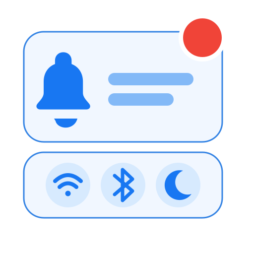
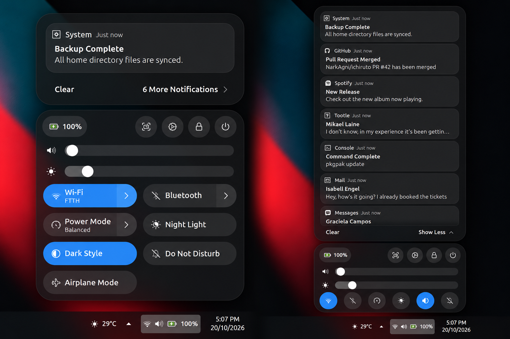
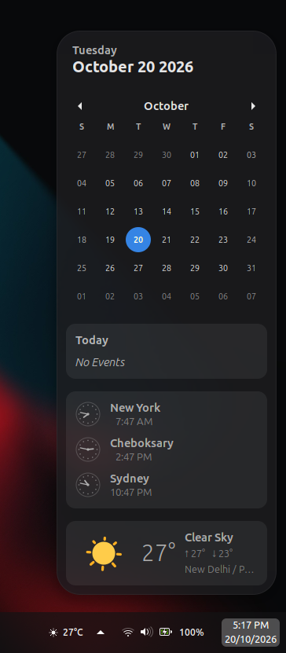
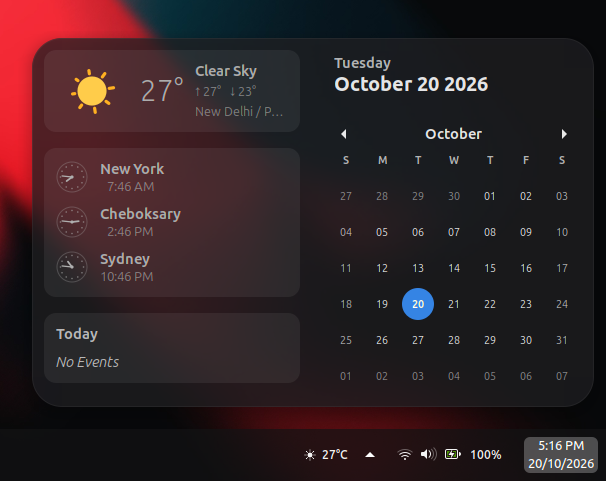
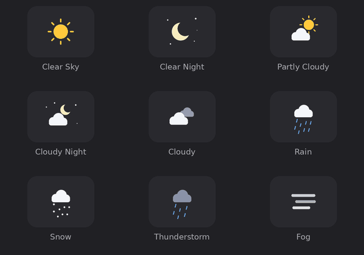
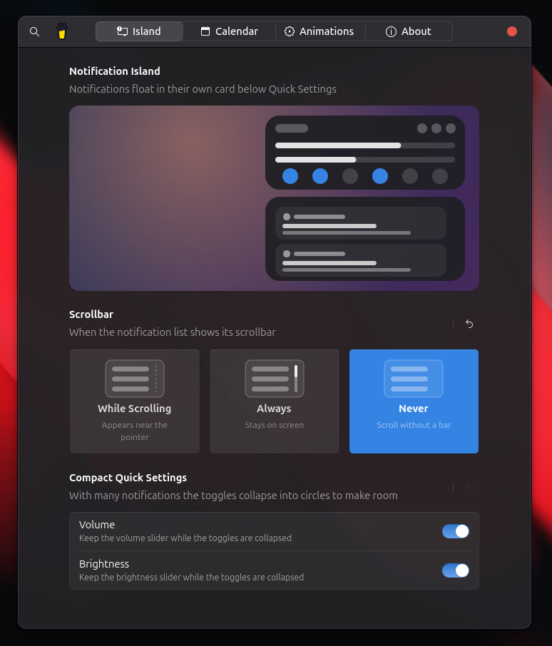
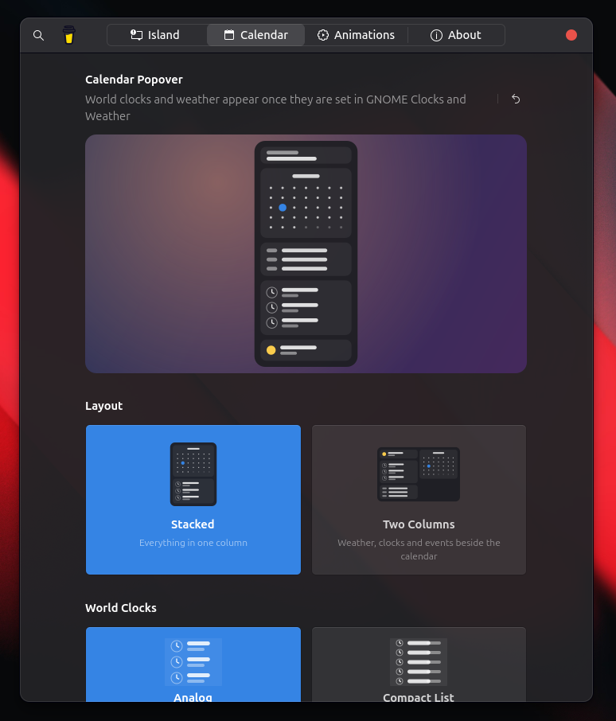
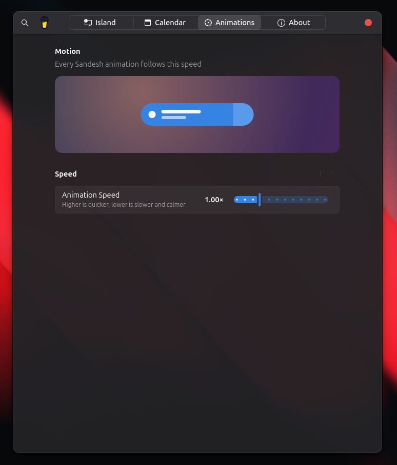

<div align="center">



# Sanket

### A floating notification island and a calmer calendar for GNOME Shell

A cleaner GNOME desktop experience with floating notifications, compact Quick Settings, world clocks, and animated weather.

<br>


<br>

**Less clutter. More clarity. A better GNOME experience.**

</div>

---

## Overview

Sanket transforms the GNOME Shell date menu into a cleaner, more functional space.

Notifications move into their own floating island beneath Quick Settings, keeping important information accessible without cluttering your calendar. The calendar becomes a useful dashboard with world clocks, animated weather, and flexible layouts.

Every detail is designed to feel natural within GNOME Shell, with smooth animations, thoughtful controls, and customizable settings.

## Features

### Notification Island

- **Dedicated notification card** - Keep notifications separate from the date menu.
- **Compact by default** - Show the newest notification with an option to expand the rest.
- **Pin notifications** - Keep important notifications at the top.
- **Expandable content** - Expand and collapse long notifications in place.
- **Smooth animations** - Fluid transitions when expanding or dismissing notifications.
- **Hover controls** - Access pin, expand, and dismiss actions when the pointer is over a notification.
- **Customizable scrollbar** - Choose whether the scrollbar is always visible, appears while scrolling, or stays hidden.

### Compact Quick Settings

- **Adaptive layout** - Wi-Fi, Bluetooth, and other toggles transform from pills into circles when space is limited.
- **Flexible controls** - Choose whether the volume and brightness sliders remain visible in compact mode.
- **Smooth transitions** - A layout that adapts naturally to available space.



### Calendar

- **Flexible layouts** - Choose between Stacked and Two Columns layouts.
- **World clocks** - Display multiple cities using analog clock faces or a compact list.
- **Animated weather** - Animated sunshine, moonlight, stars, clouds, rain, snow, lightning, and fog.
- **Smooth month transitions** - Navigate between months with fluid animations.
- **Optional events** - Show an events list and date header according to your preferences.
- **Quick setup** - Add world clocks or configure a weather location directly from the calendar.

| Stacked Calendar | Two-Column Calendar |
|:---:|:---:|
|  |  |

### Animated Weather

Weather animations bring the calendar to life with changing conditions and smooth visual effects.

<div align="center">



</div>

### Customization

- **Live previews** - Preview settings as you customize your desktop.
- **Weather animation gallery** - Explore available weather animations.
- **Unified animation controls** - Adjust the speed of Sanket animations.
- **Flexible preferences** - Customize the notification island and calendar.
- **Reset options** - Restore individual groups of settings whenever needed.

<div align="center">

| Island Settings | Calendar Settings | Animations Settings |
|:---:|:---:|:---:|
|  |  |  |

</div>

## Requirements

- GNOME Shell **45, 46, 47, 48, 49, 50, or 51**
- **GNOME Clocks** - Optional, for world clocks.
- **GNOME Weather** - Optional, for weather information.

## Installation

### GNOME Extensions

**Coming Soon**

Sanket will be available on [GNOME Extensions](https://extensions.gnome.org/) once the extension has been approved.

### Manual Installation

Clone the repository, enter the project directory, and run the installer:

```bash
git clone https://github.com/narkagni/sanket.git
cd sanket
./manage.sh install
```

After installation, restart GNOME Shell:

- **Wayland:** Log out and log back in.
- **X11:** Press `Alt` + `F2`, type `r`, and press `Enter`.

Then enable Sanket:

```bash
gnome-extensions enable sanket@narkagni
```

## Settings

Open Sanket preferences through the GNOME Extensions app or Extension Manager.

You can also open the settings directly:

```bash
gnome-extensions prefs sanket@narkagni
```

| Settings Page | Description |
|:---|:---|
| **Island** | Configure scrollbar behavior and Quick Settings controls. |
| **Calendar** | Customize layouts, world clocks, weather, events, and the date header. |
| **Animations** | Adjust the speed of Sanket animations. |
| **About** | Find project information, credits, links, and support options. |

## Optional Integrations

### Weather

Sanket uses GNOME Weather to display weather information in the calendar.

1. Install **GNOME Weather** using your distribution's package manager or software centre.
2. Open the calendar and select **Select Weather Location…**, or launch GNOME Weather directly.
3. Search for your city and select it.
4. Reopen the calendar. The weather card should appear shortly.

For automatic location detection, enable **Settings → Privacy → Location Services**.

### World Clocks

Sanket uses GNOME Clocks to display world clocks.

1. Install **GNOME Clocks** using your distribution's package manager or software centre.
2. Open the calendar and select **Add World Clocks…**, or launch GNOME Clocks directly.
3. Open the **World** tab and add your preferred cities.
4. Your selected clocks will appear in the Sanket calendar.

## Uninstallation

Run the following command from the Sanket project directory:

```bash
./manage.sh uninstall
```

Restart GNOME Shell after uninstalling.

## Support the Project

If Sanket improves your GNOME desktop experience, consider supporting its continued development.

Your contribution helps maintain the project, improve existing features, and make future enhancements possible.

<div align="center">

### Buy Me a Coffee

[](https://buymeacoffee.com/narkagni)

<br>

**Every contribution is appreciated. Thank you for supporting open-source software.**

</div>

Cryptocurrency donation addresses are also available on the **About** page in Sanket settings.

## License

Sanket is free and open-source software released under the
[GNU General Public License v3.0 or later](https://www.gnu.org/licenses/gpl-3.0.html).

Copyright © 2026 NarkAgni

---

<div align="center">

**Made for GNOME. Built with care.**

</div>

